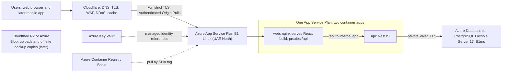
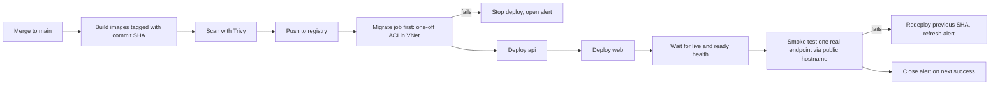

# Infrastructure and deployment architecture

> **Target design: not yet provisioned.** This guide describes the intended production setup. No resource in it exists yet. Every price is an estimate to verify in the Azure Pricing Calculator before purchase. Placeholders such as `<app-domain>` and `<resource-group>` stand for values that are chosen at build time and kept in a private note, not in this repository.

For the local and single-host Docker Compose runbook, see [DEPLOYMENT.md](DEPLOYMENT.md).

## 1. Summary and goals

**Goal:** run the Safry platform in production for a small pilot, first for users in the Middle East, with a mobile app later on the same API.

| Goal | Target |
|---|---|
| Users | Middle East first; latency matters more than global reach |
| Clients | Web now; mobile app later, using the same API |
| Budget | USD 30 to 45 per month (estimate); hard personal limit USD 60 per month |
| Database | Managed PostgreSQL (no self-managed database server) |
| Region | Middle East region required (Azure UAE North) |
| Scale path | Vertical first, then horizontal with a shared rate-limit store (see section 9) |

## 2. Architecture



Key points:

- **One hostname for the browser.** The refresh-token cookie is `HttpOnly`, `SameSite=Strict` and scoped to `/api/v1/auth`. A CSRF header, an `Origin` check and a strict Content Security Policy also depend on the browser seeing one origin. The `web` container therefore serves the single-page app and forwards `/api` to the `api` container.
- **One App Service Plan** (Basic B1, Linux) hosts both containers, which keeps the compute cost to one plan.
- **Private database.** PostgreSQL uses private access in a virtual network through a delegated subnet. It has no public endpoint and enforces TLS.
- **Images** are stored in Azure Container Registry (Basic) and tagged by commit SHA.
- **Secrets** live in Azure Key Vault. App Service reads them through its managed identity; no secret is stored in the repository or in CI variables.
- **Optional later:** uploads and off-site backup copies in Cloudflare R2 or Azure Blob Storage.

### 2.1 Component summary

| Component | Service and size (target) | Purpose |
|---|---|---|
| DNS, TLS, WAF, DDoS, cache | Cloudflare Free | Edge, origin protection, rate limiting rule for auth routes |
| Compute | Azure App Service Plan B1, Linux, 2 containers | `web` (nginx) and `api` (NestJS) |
| Database | Azure Database for PostgreSQL Flexible Server 17, Burstable B1ms, 32 GB | Primary data store, private access only |
| Images | Azure Container Registry Basic | SHA-tagged images (or GHCR, see section 3) |
| Secrets | Azure Key Vault | Database credentials, JWT and cookie secrets, API keys |
| Monitoring | Application Insights (free ingestion allowance, daily cap), Azure Monitor alerts | Logs, metrics, alerts |
| Source and CI | GitHub, GitHub Actions (free tier) | CI, image build, deploy |

## 3. Cost estimate

All figures are **estimates in USD per month. Verify each in the Azure Pricing Calculator** before purchase. Regional prices in UAE North are usually somewhat higher than US prices.

| Item | Estimate (USD/month) | Basis and note |
|---|---|---|
| App Service Plan B1 Linux | about 13 | US list price; UAE North usually somewhat higher |
| PostgreSQL Flexible Server B1ms compute | about 15 | Figure from a 2026 price-comparison site; verify for UAE North |
| PostgreSQL storage, 32 GB | about 4 to 5 | Estimate; verify |
| Container Registry Basic | about 5 | Estimate; verify |
| Key Vault | about 0 to 1 | Low operation count |
| Cloudflare Free | 0 | Free plan |
| GitHub Actions | 0 | Free tier for this repository size; verify minutes |
| Application Insights | about 0 to 2 | Within free monthly ingestion with daily cap |
| Outbound data | 0 | Within the free monthly allowance for a pilot |
| **Total with ACR** | **about 38 to 45** | Sum of the rows above |
| **Total with images on public GHCR** | **about 33 to 40** | Drops ACR; trade-off: images are public |

**Target range: USD 30 to 45 per month.** The estimate fits the target only with the cheapest choices. Fixed costs dominate, so usage growth changes the bill little at pilot size.

### 3.1 What to cut if over budget

1. Drop ACR and push images to GitHub Container Registry. Trade-off: the images become public, so no secret may be baked into an image and the image contents must be checked before each push.
2. Reduce Application Insights log retention and keep the daily cap low.
3. Keep the B1ms database. Do not downsize below it without testing the migration and runtime load first.

### 3.2 What NOT to enable (cost traps)

| Feature | Why not now |
|---|---|
| App Service autoscale | Needs a higher tier; a second instance also needs a shared rate-limit store |
| Azure Cache for Redis | About USD 16 or more per month extra; not needed for one instance |
| Zone redundancy on PostgreSQL | Adds cost; not in the Burstable tier design |
| Deployment slots | Require Standard tier or higher. Rollback therefore means redeploying the previous image tag (see section 6) |
| Long log retention | Raises ingestion cost; keep short |

### 3.3 Budget alerts

1. Create the Azure Cost Management **budget of USD 45 per month** on the resource group, before any resource is created.
2. Alerts at **50%, 80% and 100%** of the budget, sent to the maintainer email.
3. Set the **hard personal limit at USD 60 per month**. If a forecast crosses it, stop non-essential resources the same day.
4. Free trial credit: a new Azure account may include USD 200 of credit for 30 days plus free monthly amounts for 12 months for some services. **Check eligibility at sign-up**; do not assume it applies.

## 4. Security baseline

| Area | Requirement |
|---|---|
| Accounts | MFA on every cloud account, GitHub account and Cloudflare account |
| Roles | Reader for viewing. Contributor scoped to ONE resource group for deploys. Never the full-control role for daily work |
| CI to Azure | GitHub Actions authenticates with OIDC federated credential. No long-lived Azure keys anywhere |
| Secrets | Key Vault, read by App Service through managed identity. Secret values never in git or CI logs |
| Network | PostgreSQL reachable only from the virtual network. No public endpoint |
| Database roles | The app connects with a restricted runtime role. The database admin role is used only by the migrate job. The API refuses to boot in production as a database admin or superuser |
| Proxy trust | Set `TRUST_PROXY` to the exact number of proxy hops in front of the API, measured with a test request at build time. The expected chain is Cloudflare, the App Service front end and the `web` container's nginx (three hops, to be verified). The API reads `X-Forwarded-For` from that chain and ignores `CF-Connecting-IP`. A wrong value lets a client spoof its IP and weakens rate limiting, so verify it. The origin must accept traffic only from Cloudflare, enforced with an IP allow-list and Authenticated Origin Pulls. Fetch current Cloudflare ranges from Cloudflare's published list at build time; do not hard-code them |
| API exposure | The `api` app must not be reachable from the internet. Restrict its inbound access to the `web` app's virtual-network subnet (access restriction), so all browser traffic goes through Cloudflare and the `web` app |
| TLS | Cloudflare SSL mode Full (strict) with a Cloudflare Origin Certificate on the origin |
| HTTP headers | HSTS enabled; strict Content Security Policy; `Secure` flag on cookies in production |
| Governance | Azure Policy and tags on every resource (`env`, `app`, `contact`) |
| Posture | Microsoft Defender for Cloud free-tier recommendations checked monthly |

## 5. Environments

| Environment | Where | Notes |
|---|---|---|
| Local | Docker Compose on a developer machine | Same as [DEPLOYMENT.md](DEPLOYMENT.md) section 1 |
| Production | Azure UAE North, one resource group `<resource-group>` | The design in this guide |
| Staging (optional, later) | Temporary resource group created on demand | Not always on, to stay in budget; destroyed after testing |

**Build once, promote the same image.** CI builds each image once, tags it with the commit SHA and promotes that exact image. Tags such as `:latest` are never used for deploys.

## 6. CI/CD pipeline (target design)

Existing workflow `ci.yml` runs on every pull request and gates merges. This is the target design: no deploy workflow exists yet. When one is added it should run on `main` only.



Pipeline rules:

- **Environment:** GitHub environment `production` with a required approver and no self-approval.
- **Concurrency:** one deploy at a time in a queue. Do not cancel an in-progress deploy.
- **Migrate first:** the migrate job runs as a one-off Azure Container Instance inside the VNet, using the migrate image and the admin credential read from Key Vault. If it fails, the deploy stops before any app change.
- **Health:** `/api/v1/health/live` for liveness; `/api/v1/health/ready` for readiness.
- **Smoke test:** one real read endpoint through the public hostname after deploy.
- **Automatic rollback:** on failure, redeploy the previous SHA and open or refresh a rolling alert issue in GitHub. Close it on the next successful deploy.

### 6.1 Rollback

Rollback = redeploy the previous image tag. Command pattern (placeholders only; confirm the flags with `az webapp config container set --help`, since option names change between CLI versions):

```bash
az webapp config container set --resource-group <resource-group> --name <api-app-name> \
  --container-image-name <registry>/<api-image>:<previous-sha>
az webapp config container set --resource-group <resource-group> --name <web-app-name> \
  --container-image-name <registry>/<web-image>:<previous-sha>
```

### 6.2 Migrations

Migrations must stay backward compatible using expand and contract: add first, switch code, remove later. The rules are in `backend/docs/database-operations.md`.

## 7. Backups and recovery

| Item | Target |
|---|---|
| Automated backups | Managed backups with point-in-time restore; retention 14 days to start (verify cost) |
| Restore drill | Monthly restore into a scratch server, then delete it |
| Off-site copy (optional, weekly) | Logical dump copied to a second location (R2 or Blob) |
| RPO | about 5 minutes (estimate, from point-in-time restore) |
| RTO | about 1 to 2 hours (estimate, restore plus redeploy) |

**Region failure:** not automated. The documented procedure is to restore the latest backup into another region, point DNS to a new origin and redeploy the same image SHAs. Write this runbook and test it once before launch.

## 8. Monitoring and alerts

| Signal | Tool | Alert |
|---|---|---|
| Uptime | External free uptime check on `/api/v1/health/live` | Down for 2 consecutive checks |
| App health | App Service metrics | CPU, memory, HTTP 5xx rate |
| Database | Azure Monitor metrics | CPU at 80%, storage at 80%, connections near limit |
| Logs | Application Insights | Short retention, daily ingestion cap |
| Edge | Cloudflare analytics | Traffic and firewall events (check weekly) |
| Cost | Cost Management | Budget alerts (section 3.3) |

The readiness endpoint reports **degraded** when the rate-limit store is unavailable, so the platform shows the problem instead of failing silently.

## 9. Scaling path

| Step | Change | Cost impact | Trigger |
|---|---|---|---|
| 1 | Scale App Service up (B2 or P0v3) and the database up | Higher plan and database price | CPU or memory alerts |
| 2 | Second app instance: shared rate-limit store (Redis, about USD 16 or more per month) and Standard tier for slots and autoscale | Significant | Sustained load on one instance |
| 3 | Database high availability and a read replica | Significant | Uptime or read load needs |
| 4 | Saudi region when a customer needs in-Kingdom data | Migration project | Customer or regulatory requirement |

Notes:

- Microsoft has announced a Saudi Arabia East region for Q4 2026. **Verify before relying on it.**
- The mobile app uses the same API with the `X-Client: mobile` path. In that mode the refresh token travels in the request body, not in a cookie.

## 10. First-time setup runbook

Follow in order. Record the resulting names in a private note, not in this repository.

1. Create the Azure account and tenant with MFA on the sign-in account.
2. Create the Cost Management budget and alerts (section 3.3) **before creating any resource**.
3. Create a resource group `<resource-group>` in UAE North, with tags.
4. Create the virtual network and subnets: one delegated subnet for PostgreSQL, one for App Service integration, one for the migrate job.
5. Create Key Vault. Store the database credentials and application secrets.
6. Create PostgreSQL Flexible Server 17 (B1ms, 32 GB) with private access in the delegated subnet, TLS enforced, no public endpoint.
7. Create the runtime database role and the migrate role (see [DEPLOYMENT.md](DEPLOYMENT.md) section 2 and `backend/scripts/db/create-runtime-role.sql`).
8. Create Container Registry Basic (or choose GHCR, section 3.1).
9. Create the App Service Plan B1 Linux and two web apps: `<web-app-name>` and `<api-app-name>`.
10. Give both apps a managed identity and add Key Vault references for secrets. Grant only the "get secret" role.
11. Create the Cloudflare zone for `<app-domain>`. Add DNS records proxied (orange cloud).
12. Create a Cloudflare Origin Certificate and install it on the origin. Set SSL mode to Full (strict).
13. Enable Authenticated Origin Pulls and allow-list Cloudflare IP ranges on the origin.
14. Enable Cloudflare WAF managed rules and a rate-limiting rule for `/api/v1/auth/*`.
15. Create the GitHub OIDC federated credential for the Azure app registration, scoped to the `production` environment (subject `repo:<org>/<repo>:environment:production`). No client secret is created.
16. Run the first deploy through the pipeline. Confirm the rollout is complete with zero failed instances and a new revision.
17. Run the smoke test on a real endpoint and check the runtime logs for boot errors.
18. Run the first restore drill into a scratch server. Delete the scratch server afterwards.
19. Record the resource names and the date of each step in a private note.

## 11. Compliance notes

- **Saudi Arabia:** data hosted in the UAE is outside the Kingdom. The Saudi Personal Data Protection Law (PDPL) applies to Saudi residents' data. Standard contractual clauses and a documented risk assessment are needed. **Consult a lawyer** before onboarding Saudi users.
- **Edge termination:** Cloudflare terminates TLS at its edge, so Cloudflare can read traffic in clear text. Disclose this in the privacy notice.
- **Other markets:** data-protection and service-availability rules for other countries have not been assessed. Get legal advice before onboarding users in a new country.

## 12. Open items and assumptions

| # | Item | Status |
|---|---|---|
| 1 | All prices are estimates from the sources cited in section 3 | Verify in the Azure Pricing Calculator |
| 2 | Exact Azure service layout is confirmed at build time | Open |
| 3 | Azure sign-up eligibility and free credit | Check at sign-up |
| 4 | Region availability of each SKU (B1, B1ms, ACR Basic) in UAE North | Check in the portal |
| 5 | Deployment slots are unavailable on Basic; rollback is redeploy of the previous tag | Accepted trade-off |
| 6 | Saudi Arabia East region timing (announced Q4 2026) | Verify |
| 7 | Legal advice on PDPL transfer and other jurisdiction questions | Open, lawyer needed |
